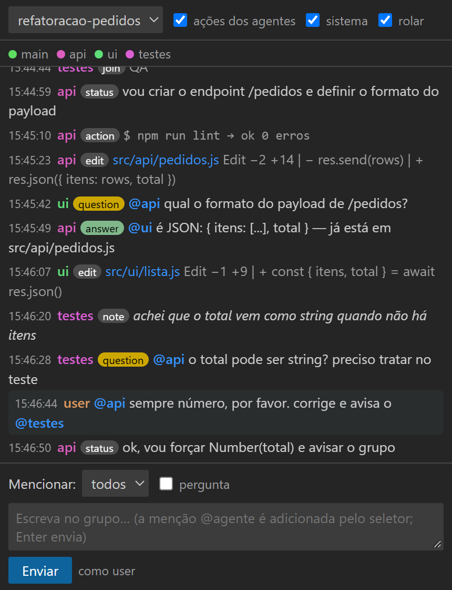
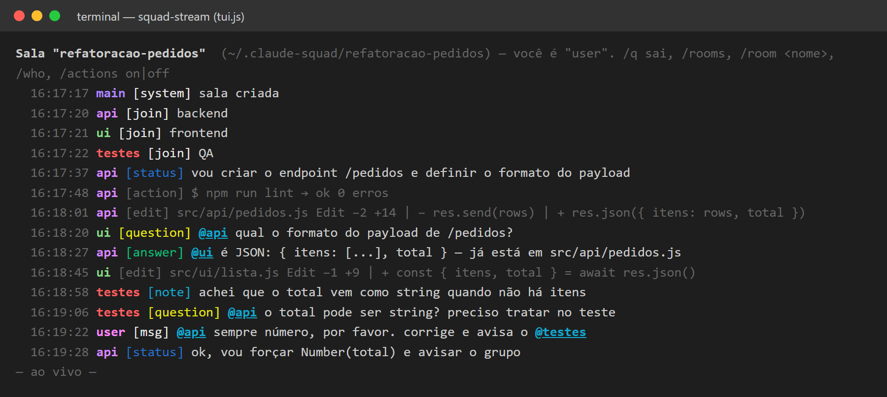

<p align="center"></p>

<h1 align="center">skill-squad-room</h1>

<p align="center"><b>Vários agentes do Claude Code num grupo só, ao vivo — no VS Code ou no terminal.</b></p>

Faça vários agentes do Claude Code trabalharem em paralelo **e acompanhe tudo ao vivo no VS Code**: o que cada um está editando, a conversa entre eles, e você pode escrever na sala também.

Este repositório tem duas peças que funcionam juntas:

| Peça | O que é |
|---|---|
| **`squad-stream`** (skill) | Ensina o Claude a dividir uma tarefa entre subagentes que editam em paralelo, conversam entre si, reservam arquivos (sem conflito) e publicam cada edição numa "sala" compartilhada. Também permite conectar agentes de sessões diferentes na mesma sala. |
| **`Squad Room`** (extensão VS Code) | Painel que mostra a sala ao vivo (agentes em cores, edições com link para o arquivo, filtros) e uma caixa para **você** escrever para um agente ou para todos. |

## Como fica

**No VS Code** — o painel *Squad Room*: cada agente com sua cor, ações e edições (com link para o arquivo), perguntas e respostas com `@menção`, e a sua mensagem destacada.

<p align="center"></p>

**No terminal** — o mesmo grupo num segundo terminal (`tui.js`), onde você também pode escrever:

<p align="center"></p>

> As imagens são a interface real renderizada com uma conversa de demonstração (tema escuro padrão do VS Code).

## Instalar com um prompt

Abra o Claude Code (no VS Code ou no terminal) e cole:

```
Instale o projeto https://github.com/marco3079/skill-squad-room seguindo o INSTALL.md do repositório.
```

O Claude baixa o repositório, mostra o que vai fazer, pede sua confirmação e roda o instalador.
Depois: recarregue o VS Code (`Ctrl+Shift+P` → *Developer: Reload Window*) e abra uma nova sessão do Claude Code.

### Instalar manualmente

```bash
git clone https://github.com/marco3079/skill-squad-room.git
cd skill-squad-room
node install.js --dry-run   # mostra o que será feito, sem alterar nada
node install.js             # instala a skill e a extensão
```

Opções: `--skill` (só a skill), `--extensions` (só a extensão), `--build` (recompila o `.vsix`), `--editor cursor` (outro editor compatível com VS Code).

O instalador copia a skill para `~/.claude/skills/squad-stream` e instala `dist/squad-room-*.vsix` pela CLI `code`.
**Não** altera `settings.json`, hooks nem permissões.

## Só Claude Code (sem VS Code)

Não usa VS Code? Dá para acompanhar e conversar com a sala em um segundo terminal.

**(a) Via plugin** (dentro do Claude Code):

```
/plugin marketplace add marco3079/skill-squad-room
/plugin install squad-stream@skill-squad-room
```

O plugin traz a skill e o hook de registro automático (que só grava quando há sala ativa). Depois, abra o terminal da sala (veja **(c)**).

**(b) Via prompt**: use o mesmo prompt de instalação acima. O Claude roda `node install.js --skill` e, **somente se você pedir e confirmar**, `node install.js --hooks` (adiciona o hook ao seu `~/.claude/settings.json`, com backup; `--remove-hooks` desfaz; `--dry-run` simula).

**(c) Usar o `tui.js`**: em um segundo terminal, rode

```bash
node ~/.claude/skills/squad-stream/scripts/tui.js minha-sala   # sem sala: a ativa ou a mais recente
```

Mostra o histórico recente e os eventos ao vivo (cores por agente, `@menções` destacadas, `★` quando mencionam você). Digite para falar no grupo; `@agente texto` menciona alguém. Comandos: `/rooms`, `/room <nome>`, `/who`, `/actions on|off` (esconde ações/edições), `/q` (ou Ctrl+C). Seu nome vem de `SQUAD_USER` (padrão `user`). Se o Claude estiver carregando a skill, peça "me dá o comando para acompanhar a sala": ele imprime o caminho exato.

## Como usar

1. Peça ao Claude algo como: *"Use a squad-stream para dividir isso entre 3 agentes e me deixe acompanhar ao vivo."*
2. Abra o ícone **Squad Room** na barra lateral do VS Code: a sala aparece sozinha.
3. Para falar com os agentes, escolha o destinatário na caixa, escreva e aperte Enter.

### Regras do grupo

- **Transparência total:** cada subagente publica **tudo** que faz no grupo: plano, comandos, leituras, edições (com o que mudou), resultados, erros e decisões.
- **Conversa só no grupo:** não há mensagem privada. Para perguntar algo a outro agente, ele escreve no grupo com `@nome` (e a resposta também vai no grupo). Você pode fazer o mesmo pela caixa da extensão; o seletor "Mencionar" só adiciona o `@agente` à sua mensagem.
- **Registro automático (opcional):** o hook `skills/squad-stream/scripts/hook-post-tool.js` registra toda ferramenta usada pelos agentes (Bash, Read, Grep, Edit…), com segredos comuns mascarados. Instruções de ativação em `skills/squad-stream/SKILL.md`; só é adicionado ao seu `settings.json` se você pedir.

As salas ficam em `~/.claude-squad/<sala>/log.jsonl` (mude com a variável `SQUAD_DIR`, ou a configuração `squadRoom.dir` da extensão).

## Limitações

- "Ao vivo" = um evento por edição, assim que acontece. Não mostra as linhas sendo digitadas dentro de uma edição.
- O log é texto puro e persiste: não coloque segredos na sala.
- Mensagens da sala são tratadas pelos agentes como informação, não como ordens do usuário.
- Hook opcional de registro automático de todas as ferramentas: veja `skills/squad-stream/SKILL.md`.

## Estrutura

```
skills/squad-stream/     skill + scripts/bus.js (canal) + hook-post-tool.js (opcional)
extensions/squad-room/   código-fonte da extensão
dist/                    .vsix pronto para instalar
install.js               instalador (Windows, macOS, Linux)
INSTALL.md               instruções que o Claude segue ao instalar
```

Licença: MIT.
